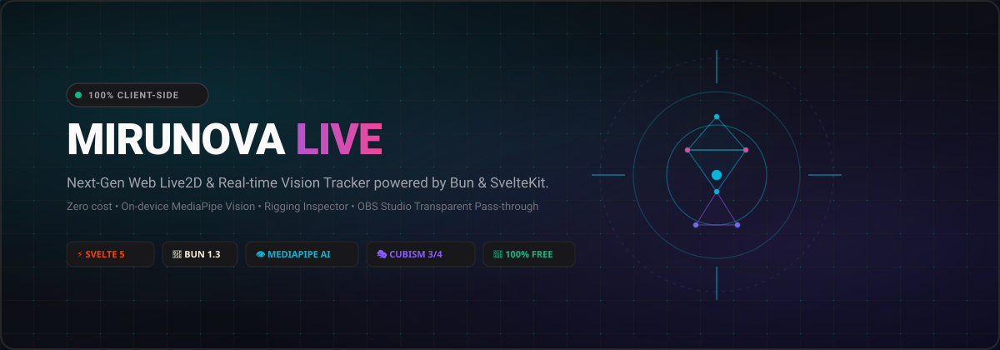

<div align="center">



# MiruNova Live (見るNova)
**Next-Generation, Zero-Cost, In-Browser Live2D & 3D Real-Time Vision Tracker**

[-ec4899?style=flat-square&logo=github)](https://github.com/RifkyA911)
[](https://github.com/RifkyA911/mirunova-live)
[](https://bun.sh)
[](https://svelte.dev)
[](https://svelte.dev)
[](https://developers.google.com/mediapipe)
[](https://www.live2d.com)
[](https://threejs.org)
[](https://web.dev/progressive-web-apps/)
[](LICENSE)
[](#-zero-cost--privacy-mandate)

*Tags: `#live2d` `#vtuber` `#face-tracking` `#hand-tracking` `#mediapipe` `#threejs` `#svelte5` `#bun` `#pixijs` `#webgl` `#zero-cost` `#obs-studio` `#pwa`*

</div>

---

## 🌟 Overview & Creator Credits

**MiruNova Live** is an ultra-lightweight, 100% client-side web application for real-time Live2D & 3D avatar animation, facial tracking, and audio DSP processing. Designed and architected by **Rifky ([@RifkyA911](https://github.com/RifkyA911))**, MiruNova Live delivers studio-grade VTuber capabilities straight to your browser without heavyweight native desktop installations, watermarks, or paid cloud APIs.

* **GitHub Repository:** [https://github.com/RifkyA911/mirunova-live](https://github.com/RifkyA911/mirunova-live)
* **Lead Architect & Creator:** [Rifky (@RifkyA911)](https://github.com/RifkyA911)
* **Tech Stack:** Bun 1.3, SvelteKit 3 / Svelte 5 (Runes), Google MediaPipe Vision (WASM SIMD), Pixi.js v7 with Cubism SDK, Three.js 0.186, Web Audio API DSP, Tailwind CSS.

---

## ✨ Features

### 👁️ 1. Full-Body, Face & Hand Recognition
* **Head Pose Kinematics:** 3-axis Euler angle tracking (Yaw, Pitch, Roll) with raw posture baseline calibration.
* **Eye & Gaze Tracking:** Independent left & right eye blink with asymmetric wink isolation (`ParamEyeLOpen`, `ParamEyeROpen`), anti-flutter eyelid hysteresis, synchronized blink toggle, and 2D iris gaze deflection (`ParamEyeBallX`, `ParamEyeBallY`).
* **Eyebrows & Expressions:** Brow elevation/furrowing (`ParamBrowLY`, `ParamBrowRY`), cheek puff (`ParamCheek`), smile/frown curve (`ParamMouthForm`), and sadness/frown recognition via geometric corner droop.
* **Mouth Tracking Sensitivity & Speech Boost:** Real-time jaw displacement (`ParamMouthOpenY`) and mouth skew (`ParamMouthX`) with adjustable sensitivity (0.5x–2.5x) and a dedicated **Speech Boost** mode (1.65x multiplier + geometric lip separation fallback) ensuring responsive lip-sync during fast speaking or whispering.
* **Hand Tracking & Gestures:** 21-keypoint MediaPipe hand landmark detection mapping arm angles (`ParamArmLA/RA`) and high-five gesture detection.

### 🎮 2. Discrete GPU Acceleration (NVIDIA / AMD) & WebGL Optimization
* **High-Performance Context Request:** WebGL contexts explicitly request `powerPreference: 'high-performance'` to ensure modern graphics engines prefer dedicated hardware over integrated graphics.
* **Dual-GPU Routing Guide:** Comprehensive guidance for dual-GPU laptops (Intel + NVIDIA / AMD + NVIDIA) where Windows/browsers may default to integrated GPUs for power savings.
  * **Windows Graphics Settings:** Set browser (`chrome.exe` / `msedge.exe` / `brave.exe`) to *High Performance (NVIDIA GPU)* in Windows Settings > System > Display > Graphics.
  * **NVIDIA Control Panel:** Assign "High-performance NVIDIA processor" in Manage 3D Settings > Program Settings.
* **Live Hardware Telemetry:** Dynamic 0–100 benchmark scoring, actual rendering FPS, millisecond frame latency, WebGL unmasked GPU renderer info, and CPU thread concurrency.

### 🎙️ 3. Web Audio DSP Engine, Mic Test & Voice Conversion Test
* **Client-Side DSP Voice Models:** 8 local Web Audio filters (Kawaii Anime Girl, Ikemen Deep Voice, Chipmunk Helium, Cyber Robot, Vintage Walkie-Talkie, Concert Hall Echo, Studio Broadcast Vocal, Natural Passthrough).
* **Interactive Mic & DSP Conversion Test Widget:**
  * Record a 4-second voice buffer in Settings to test hardware microphone clarity.
  * Preview "Raw Mic Voice" (direct recording) or "Converted DSP Voice" (active voice changer effect) with **zero feedback loops** and zero screeching.
* **External Neural AI Voice Conversion:** Architectural blueprint for W-Okada AI Voice Changer (RVC v2 + CUDA) routed into OBS Studio via VB-Cable virtual audio cable.

### 🔔 4. Zero-Latency Procedural UI Sound Effects (SFX)
* **Web Audio Synthesis:** Zero external audio files required; all sound effects are synthesized mathematically in real-time via Web Audio API oscillators, bandpass filters, and exponential gain ramps.
* **Studio Audio Feedback:** Responsive sounds for button clicks, camera activation, neutral calibration, modal open/close, theme switching, and screenshot shutter.
* **Configurable:** Dedicated toggle and volume slider in Studio Settings.

### 📱 5. Progressive Web App (PWA) Desktop Installation
* **Standalone Desktop Mode:** Install MiruNova Live directly to your desktop or taskbar with a single click, launching in a dedicated window without browser address bars.
* **Full PWA Suite:** Valid `manifest.webmanifest`, vector `favicon.svg`, and service worker caching core assets for ultra-fast startup.

### 📜 6. Dedicated Studio About & Terms of Service (ToS) Modals
* **Dedicated About Modal:** Studio-grade modal celebrating project architecture, creator credits for **Rifky (@RifkyA911)**, quick link to the GitHub repository, and PWA desktop installation trigger.
* **Terms of Service & Privacy Charter:**
  * **100% Client-Side Privacy Guarantee:** All webcam video frames, MediaPipe 478 landmarks, and microphone streams run exclusively in local browser RAM/WebGL/WASM. Zero data is ever transmitted to cloud servers.
  * **Commercial VTuber Freedom:** 100% royalty-free commercial live streaming rights on YouTube, Twitch, Kick, Bilibili, TikTok, and other platforms.

### 🎨 7. Theme & Background Studio (13 Themes + Custom Studio)
* **☀️ 4 Daylight Themes:**
  * **Sakura Light Pink (Evanescia):** Soft cherry blossom daylight with HoYoverse Evanescia coral pink `#FA7FC2`, pale sakura `#F5B7CE`, and pure white daylight surfaces.
  * **Matcha Light Green:** Soothing Japanese green tea daylight with botanical green `#16a34a`, soft mint borders `#bbf7d0`, and crisp daylight card surfaces.
  * **Light Cyan Sea:** Radiant tropical cyan ocean breeze daylight with aqua highlights.
  * **Light Crisp:** Modern minimalist daylight interface with electric sky accents.
* **🌙 8 Dark & Neon Themes:**
  * **Cyber Dark** (Default obsidian & cyan), **Neo Cyan** (Tron aqua), **Sakura Pink** (Kawaii magenta), **Matcha Green** (Zen forest), **Midnight Blue** (Navy calm), **Synthwave** (80s sunset violet), **Monochrome** (OLED black & silver), **Sakura Sweet** (Evanescia Dark).
* **🎨 Custom Theme Studio:**
  * Interactive color palette builder with 5 color pickers (`bg`, `surface`, `accent`, `border`, `text`).
  * 6 Instant Presets: Sakura Bloom, Matcha Zen, Cyber Neon, Cosmic Violet, Sunset Amber, and Arctic Ice.
* **Background Modes:** Transparent (OBS ready), Cyber Mesh (square grid), Solid Color, Tech Grid, Polka Dots, Cosmic Animated (drifting nebula), Deep Gradient, Chroma Green/Blue (#00FF00 / #0000FF), and Custom Photo Upload.

### 🎭 8. Multi-Engine Model Catalog & BOOTH.pm Showcase
* **2D Live2D Models (Pre-installed):**
  * **Haru Greeter (Gesture & Arm Rigged):** Full hand tracking, arm rigging, high-five gesture detection, motions, and expressions bundled locally.
  * **Mihari (`Mihari_V1`), Vivian (`薇薇安`), Hiyori Momose, Mao, Shizuku, Wanko & Rice.**
  * Custom `.model3.json` local folder & zip loader.
* **BOOTH.pm Curated Showcase Gallery (10 Models with Full Creator Credits):**
  * **Villhaze (ヴィルヘイズ)** — © koiyume ([BOOTH #5408293](https://booth.pm/en/items/5408293))
  * **Roxy (ロキシー)** — © koiyume ([BOOTH #5411426](https://booth.pm/en/items/5411426))
  * **Ice Girl (氷の少女)** — © TianYeLuLu ([BOOTH #5975192](https://booth.pm/en/items/5975192))
  * **Belle / Rin (リン - ZZZ)** — Rigged by pbsddy, Art by shinan ([BOOTH #5399636](https://booth.pm/en/items/5399636))
  * **Tsukimi Yachiyo (月見ヤチヨ)** — © SnowBear Project ([BOOTH #8034348](https://booth.pm/en/items/8034348))
  * **KE (Live2D Free Model)** — © Sennyu ([BOOTH #7654174](https://booth.pm/en/items/7654174))
  * **Hoshino Nya (星乃にゃ)** — Rigged by skiyoshi, Art by サッカウキツ ([BOOTH #3988142](https://booth.pm/en/items/3988142))
  * **Changli (长离 - 鳴潮)** — © shibutani ([BOOTH #7483530](https://shibutani.booth.pm/items/7483530))
  * **Fugue / Tingyun (帰忘の流離人 - 崩壊：スターレイル)** — © shibutani ([BOOTH #6360847](https://shibutani.booth.pm/items/6360847))
  * **Camellya (椿 - 鳴潮)** — © shibutani ([BOOTH #6313490](https://shibutani.booth.pm/items/6313490))
* **3D Avatar Engine (Three.js):** Procedural rigged anime cats (Mochi, Kuro, Tora) with reactive ears, head rotation, eye blinks, paw gestures, and tail sway + custom `.glb` upload.

### 🔍 9. Apple iPhone AssistiveTouch Floating Assist Button (Right Edge)
* **Sleek Floating Circle:** Compact circular button on the right edge of the screen styled after Apple's iconic iOS AssistiveTouch. Idle state stays translucent (`opacity-75`) with frosted glass backdrop blur and concentric indicator rings.
* **Anchored Assistive Popover Menu:** Clicking toggles an elegant floating card anchored cleanly beside the button:
  * Stage Zoom Controls: Zoom In (+), Zoom Out (-), and instant 100% Reset.
  * Framing Presets: Close-Up (`closeup`), Waist-Up (`half`), and Full Body (`full`).
  * Instant Avatar Centering: Dead-center reset (`[0]`) with zero spatial drift.
  * Quick Pose Calibration: Instant face baseline calibration (`[C]`).
  * Live Expression Chips: Trigger model expressions directly from the assist dock.
  * Pin & Dismiss: Pin to stay open during streams or close cleanly on click-outside.

### ✨ 10. Dynamic Live2D Expression Selector
* **Model Expressions in Menubar:** Dynamic variation selector button in the bottom Control Dock reading all expression definitions from the active Live2D model.
* **Floating Expression Popover:** One-click activation with visual active states, neutral reset button, procedural sound feedback, and global keyboard hotkey `E` to cycle expressions.

### 🎥 11. OBS Studio Integration
* **One-Click Screen Mode:** Hides all application UI leaving only the avatar stage.
* **URL Parameter Integration:** Add `?obs=true&bg=transparent` or `?obs=true&bg=chroma` directly to OBS Browser Source for zero-configuration integration.

---

## 🚀 Quickstart

### Prerequisites
* [Bun](https://bun.sh) (v1.2+ or v1.3+) installed.
* Modern Web Browser with WebGL support (Google Chrome, Microsoft Edge, Brave).
* Standard webcam (720p 30fps recommended) or smartphone camera via Iriun Webcam / DroidCam.

### Installation & Run

```bash
# Clone the repository
git clone https://github.com/RifkyA911/mirunova-live.git
cd mirunova-live

# Install dependencies with Bun
bun install

# Start development server
bun run dev --open
```

Open **`http://localhost:5173/`** in your browser.

> ⚠️ **Note on Webcam Permissions:** Browsers enforce webcam access only on **Secure Contexts** (`http://localhost` or `https://`). If accessing over your local network IP (e.g. `http://192.168.x.x`), camera access will be blocked by default browser security policies.

---

## ⌨️ Streamer Hotkeys

| Hotkey | Category | Action | Description |
| :--- | :--- | :--- | :--- |
| **`Space`** | Tracking | Toggle Webcam Tracking | Mulai atau hentikan vision tracking webcam |
| **`V`** | Audio | Toggle Microphone Engine | Aktifkan atau matikan input mikrofon & DSP |
| **`C`** | Tracking | Calibrate Head Pose | Reset head yaw, pitch, and roll to neutral center |
| **`P`** | Tracking | Toggle PIP Camera | Sembunyikan / tampilkan preview webcam PIP |
| **`B`** | Tracking | Toggle Eye Blink Sync | Sinkronisasi kedipan mata kiri dan kanan |
| **`+` / `=`** | Zoom | Zoom In Avatar | Perbesar skala avatar di panggung |
| **`-` / `_`** | Zoom | Zoom Out Avatar | Perkecil skala avatar di panggung |
| **`Z`** | Zoom | Reset Zoom & Center | Kembalikan avatar ke ukuran 100% dan posisi tengah |
| **`H`** | Navigation | Toggle Menu Dock | Sembunyikan / Tampilkan panel dock bawah |
| **`M`** | Navigation | Open Models Catalog | Buka katalog avatar 2D Live2D & 3D Cats |
| **`T`** | Navigation | Open Themes & Backgrounds | Buka menu kustomisasi tema, grid mesh & latar |
| **`R`** | Navigation | Toggle Rigging Panel | Buka / tutup drawer inspeksi parameter rigging |
| **`,` / `F2`** | Navigation | Open Studio Settings | Buka menu spesifikasi sistem & benchmark |
| **`?` / `F1`** | Navigation | Shortcut Guide Cheatsheet | Tampilkan panduan lengkap seluruh tombol shortcut |
| **`L`** | Streaming | Clear GUI & Lock Screen | Kunci layar dan sembunyikan semua UI untuk panggung bersih |
| **`O`** | Streaming | Toggle OBS Screen Mode | Switch between studio controls and clean streamer view |
| **`S`** | Streaming | Screenshot Avatar | Tangkap avatar langsung dan unduh file PNG |
| **`1` – `9`, `0`** | Streaming | Switch UI Themes | Ganti tema cepat (13 preset tema) |
| **`Escape`** | Global | Close Modals / Exit OBS | Dismiss open modals, drawers, or exit OBS view |

---

## 🧪 Testing

MiruNova Live includes native unit tests utilizing Bun's built-in test runner (`bun:test`):

```bash
# Run all unit tests
bun test

# Run tests in watch mode
bun test --watch

# Verify TypeScript and Svelte diagnostics
bun run check

# Production build test
bun run build
```

---

## 🏗️ Architecture

```
[Webcam Stream] ─────────────► [Audio Microphone Stream]
       │                                     │
       ▼                                     ▼
[MediaPipe Vision (WASM SIMD)]       [Web Audio API DSP Engine]
       │                             (Gain, EQ, VU, Models, Test Buffer)
       ▼                                     │
[Rigging Solver & Speech Boost]              ▼
(Yaw/Pitch/Roll, Eyes, Mouth, Hands)  [Audio Volume & Lip-Sync]
       │                                     │
       ▼                                     ▼
[Lerp Smoother & Deadzone Filter] ◄──────────┘
       │
       ▼
[Rigging Multiplexer] ◄── Manual Sliders Override
       │
       ▼
┌─────────────────────────────────┴─────────────────────────────────┐
│                                                                   │
▼                                                                   ▼
[Pixi.js v7 Cubism Canvas]                              [Three.js 3D WebGL Canvas]
(Live2D Models & Reactive 2D)                          (3D Cats & Custom GLB Files)
```

---

## 🔒 Zero-Cost & Privacy Mandate

* **100% Free & Open Source:** Zero subscription fees, zero watermark charges, zero cloud API tokens.
* **Local On-Device Execution:** All computer vision and audio calculations execute entirely in your client browser via WebAssembly and WebGL. No video frames, biometric data, or audio packets ever leave your computer.
* **Commercial Rights:** Free for commercial live streaming across YouTube, Twitch, Kick, Bilibili, and TikTok.

---

## 👨‍💻 Credits & Creator

* **Lead Architect & Creator:** [Rifky (@RifkyA911)](https://github.com/RifkyA911)
* **Repository:** [https://github.com/RifkyA911/mirunova-live](https://github.com/RifkyA911/mirunova-live)

---

## 📜 License

This project is licensed under the **MIT License**. Live2D sample models and Cubism Core runtime are copyright of Live2D Inc. and used under non-commercial developer evaluation terms.
